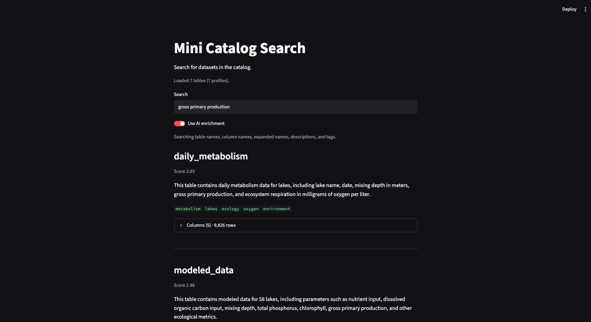

# mini-catalog


A small, end-to-end data catalog demo. It profiles a folder of CSV tables, uses an LLM to expand abbreviated column names and write a short description and tags for each table, and makes the tables searchable with BM25 in a Streamlit app.

It is a learning project inspired by [SmartCat](https://pages.cs.wisc.edu/~anhai/projects/smartcat/), built to understand the problem SmartCat addresses: scientific and enterprise tables often have cryptic column names (`GPP_mgO2L`, `DOCin`, `TPHat`), which makes them hard to find.




## Key findings

**1. AI enrichment makes abbreviated tables findable.** I ran the same queries against two BM25 indexes: one built from the original table and column names only, and one that also includes the LLM's expanded column names, description, and tags.

| Query | Top result, names only | Top result, with enrichment |
|---|---|---|
| gross primary production | *(no match)* | daily_metabolism |
| dissolved organic carbon | *(no match)* | modeled_data |
| total phosphorus | *(no match)* | modeled_data |
| chlorophyll a | *(no match)* | modeled_data |
| lake name | modeled_data | daily_metabolism |
| mg O2 L | daily_metabolism | daily_metabolism |
| total nitrogen | *(no match)* | modeled_data ⚠️ wrong |
| invasive species | fish_sonar_whole_lake ⚠️ wrong | fish_sonar_whole_lake ⚠️ wrong |

Four queries found nothing from the original names alone (for example, `DOCin` contains none of the words "dissolved organic carbon") and found the right table first once the expansions were added. The table also shows where keyword search breaks down:

- **Partial matches look like hits.** "total nitrogen" returns `modeled_data` only because of the word "total" in "Total Phosphorus". There is no nitrogen data.
- **Same word, different meaning.** "species" matches fish species and tree species, and "primary" matches both "gross primary production" and "primary residence".
- **Longer documents dilute scores.** For "mg O2 L", the enriched document scores lower (7.30 vs 7.86) with exactly the same matching words, because BM25 normalizes by document length.

**2. A dataset title helps the description, not the column names.** Adding the dataset title from the data source (e.g. "Northern Wisconsin Lake Resident Survey 2005") changed the survey table's description from "survey data related to lakes" to one that names the survey, region, and year. It did not measurably improve column expansions: two runs with identical settings already differed on 10 of 80 columns, and runs with vs. without the title differed on 8. Raw outputs are in [`experiments/`](experiments/).

**3. The LLM is good at domain vocabulary but not at survey codes.** It correctly expanded `nasc` to "Nautical Area Scattering Coefficient" and `zebra` / `rusty` to "Zebra Mussels" / "Rusty Crayfish". It failed on survey-specific codes: `nolak1` became "No Lake 1" although its values are lake names, and `XVnew_res` became "Extremely Very New Residence".

## How it works

```
data/raw/*.csv
  → 1. catalog/profile.py   → output/profiles.json   (rows, columns, dtype, missing ratio, unique count, samples)
  → 2. catalog/enrich.py    → output/catalog.json    (expanded column names, description, tags)
  → 3. catalog/search.py                             (BM25 index over names + enrichment)
  → 4. app.py                                        (Streamlit search UI)
```

- **1. Profiling** reads each CSV with pandas and records basic statistics plus three distinct sample values per column (truncated to 50 characters), so the LLM gets a compact view of the table.
- **2. Enrichment** sends one table profile at a time to `gpt-4o` in JSON mode. The expansion rules in [`catalog/rules.txt`](catalog/rules.txt) are adapted from [Columbo](https://github.com/anhaidgroup/columbo). Results are cached in `catalog.json`, and a result is saved only if it returns every column name exactly, in order.
- **3. Search** builds one text document per table and tokenizes it, splitting `snake_case`, `camelCase`, and digit-letter boundaries (`GPP_mgO2L` → `gpp mg o2 l`). A switch builds the index with or without the enrichment, for the comparison above.
- **4. App** shows ranked results with descriptions and tags, a per-table column view that joins the LLM expansions with the profile statistics, and a toggle to search with or without AI enrichment.

## How to run

Requires Python 3.12.

```bash
python -m venv .venv
source .venv/bin/activate
pip install -r requirements.txt
```

**See the app right away** (no API key needed; `output/catalog.json` is included):

```bash
streamlit run app.py
```

**Rebuild the catalog from the CSVs:**

```bash
python catalog/profile.py      # writes output/profiles.json
cp .env.example .env           # then put your OpenAI API key in .env
python catalog/enrich.py       # writes output/catalog.json; skips tables already in it
```

To re-enrich a table (for example after editing `rules.txt`), delete its entry from `output/catalog.json`, or delete the file to redo all tables.

## Limitations

- **Small, skewed corpus.** Only 7 tables, 5 of them about lakes. With so few documents, BM25's inverse document frequency is unstable; "lakes" appears in most tables and carries almost no weight.
- **LLM output varies between runs** even at temperature 0, so descriptions, and therefore search results, can change after re-enrichment. For example, one run described the survey's invasive species and a later run did not, which is why "invasive species" fails above.
- **No ground-truth evaluation.** I checked expansions by hand against sample values, not against the datasets' official column definitions.
- **Missing-value codes are treated as data.** The survey appears to use `9`, `8`, and `-99` for non-responses (I have not confirmed this against its codebook); profiling counts them as real values.
- **Keyword search only.** BM25 cannot match synonyms ("wheelchair" vs. "ADA") or tell apart meanings of the same word.

## Next steps

What I would change if this were to grow into a catalog that other people deploy.

**Understanding the data**
- **Read declared missing-value codes from metadata.** EDI datasets come with EML metadata, which can declare missing-value codes per column. Pass those to the CSV reader so `null_ratio` and samples reflect real values.
- **Flag suspected codes when there is no metadata.** Values like `-99`, `-999`, or a frequent `9` at the top of a 0-4 scale can be reported as "suspected missing codes" in the profile, for the LLM or a person to confirm, instead of being silently dropped or kept.
- **Use the source's column definitions.** EML also includes a definition for each column. Where it exists, it is both a better hint than samples and ground truth for evaluation.

**Splitting names into words**
- **Index several candidate splits instead of choosing one.** No single rule handles every name: the current rules split `mgO2L` into `mg O2 L` but leave `DOCin` whole, and adding a rule for acronyms would turn `DOCin` into `DO Cin`. For keyword search, indexing `docin`, `doc in`, and `do cin` together costs little and finds more.
- **Reuse the LLM's own split.** Columbo already asks the LLM to tokenize a name before expanding it. Having the enrichment step return that split for each column would give the search index a context-aware tokenization (for example, using the table name to decide between candidates).

**Making LLM output reliable**
- **Vote across runs.** Since repeated runs disagree on about 1 in 8 columns, run the expansion several times and keep the majority answer. Columns where runs disagree are good candidates for human review.
- **Let people correct results.** Show low-confidence expansions in the app, let users accept or edit them, and keep those edits when the table is re-enriched.
- **Validate output beyond column names.** Enforce the tag rules in code (one result returned the uppercase tag `ADA`; others include the uninformative tag `data`).
- **Invalidate the cache precisely.** Key cached results by a hash of the profile, the rules, and the model, so that changing `rules.txt` or a CSV re-enriches only the affected tables.

**Search**
- **Evaluate with labeled queries.** Build a set of queries with known correct tables (or use the [Polaris](https://github.com/anhaidgroup/polaris) dataset) and report metrics such as recall@k, instead of judging a handful of queries by eye.
- **Add semantic search.** Combine BM25 with embedding-based retrieval to handle synonyms and different wording, and weight fields (tags and expanded names vs. long descriptions) to reduce the length dilution seen above.

**Deployment**
- **Support local or self-hosted models.** Enrichment sends sample values to an external API, which many organizations cannot do with their data. The model provider should be configurable, with an option to send no sample values.
- **Handle wide tables.** Split tables with many columns (the survey has 80) into batches so the prompt stays small and no column is dropped.

## Data

7 tables from the [EDI Data Portal](https://portal.edirepository.org) (North Temperate Lakes LTER and GLEON) and the [City of Madison Open Data](https://data-cityofmadison.opendata.arcgis.com/) portal. Sources, citations, and licenses are listed in [`data/SOURCES.md`](data/SOURCES.md).
